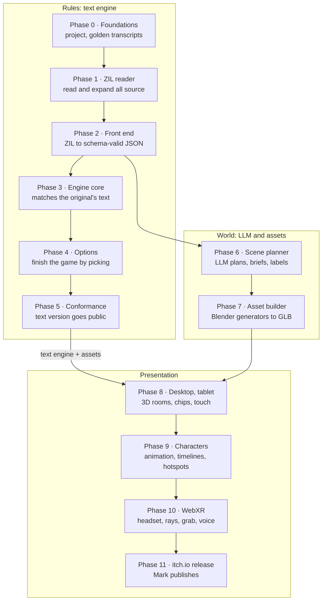

# ZXR engine build plan

2026-10-21 · Mark Davey

This plan builds the ZXR engine in 12 phases (0 to 11), using Zork II as the test game. It ends with Zork II playable on desktop, tablet and WebXR headsets from one build, and published on itch.io. It follows the format and working method of rougeXR's implementation plan, and turns the [ZXR design doc](design.md) into small, reviewable steps.

**The order matters.** Phases 0 to 5 build a complete, provably correct text-and-options version of Zork II with no 3D at all. Only then do phases 6 to 10 add scenes, assets, characters and XR on top. This is the same desktop-first order that worked for rougeXR, and it means every 3D bug can be told apart from a rules bug.

**What we are porting, measured from the [Zork II source](https://github.com/historicalsource/zork2) (MIT license, Microsoft, 2025):**

| Item | Count | Where |
|---|---|---|
| ZIL source | 11,978 lines in 11 files | `2dungeon.zil`, `2actions.zil`, shared `g*.zil` library |
| Rooms | 86 | `2dungeon.zil` |
| Objects | 165 | 147 in `2dungeon.zil`, 18 global objects in `gglobals.zil` |
| Routines | 441 | 176 game actions, 189 verbs, 42 parser, the rest library |
| Syntax lines | 267 | `gsyntax.zil` |
| Timed events (interrupts) | 24 | `I-WIZARD`, `I-DRAGON`, `I-BALLOON`, `I-PRINCESS` and others |
| Macros | 15 | `gmacros.zil` (`TELL`, `VERB?`, `PROB`, `ENABLE`...) |
| Reference story file | `COMPILED/zork2.z3` | Runs in any Z-machine interpreter; our ground truth |

**Working method (from rougeXR):**

- Work in step order. Each step is one coherent change with its own completion check; split a step into lettered substeps if it touches unrelated modules.
- Tick a step only after its check passes, and record the commit and test result in a short phase note.
- Never mark unsupported ZIL behaviour as working. Anything stubbed is listed in a capability manifest and in the rules ledger.
- Keep a **rules ledger**: every place ZXR intentionally behaves differently from the original `zork2.z3` is written down with the reason.

## At a glance


*The rules are finished and proven before any 3D work begins.*

The world track (phases 6 and 7) can start as soon as the front end emits JSON, so it runs alongside phases 3 to 5. Phases 9 and 10 depend only on phase 8 and can also run side by side.

## Ground rules and contracts

These rules hold in every phase. They are rougeXR's boundaries applied to ZIL.

1. **The engine is headless.** `src/engine` imports no DOM, three.js, WebXR, storage, network or wall clock. A lint check fails the build if it does.
2. **Game logic is never generated by an LLM.** Rules come only from the deterministic ZIL front end. The LLM may write scene plans, asset briefs, Blender generators and option labels, all of which are reviewable JSON or Python.
3. **The world model is authoritative.** Renderers read a `PlayerObservation` and never write game state. Any view can be destroyed and rebuilt from the latest observation.
4. **Time advances only on actions, by the original's rules.** One chosen option is one pass through the translated `MAIN-LOOP-1`. Whether the clock runs is decided by that code, not by the engine: `CLOCKER` runs after every parsed action except `TELL BRIEF SUPER-BRIEF VERBOSE SAVE VERSION QUIT RESTART SCORE SCRIPT UNSCRIPT RESTORE`, so look, inventory and failed actions cost a turn, and `V-WAIT` runs the clock up to three times itself. Animation and head movement never advance time.
5. **Determinism.** One seeded RNG owned by the engine; same seed and same option ids give the same game, byte for byte. Queries (`options()`, `observe()`) never change state, the RNG or the save hash.
6. **The original is the specification.** When the port and `zork2.z3` disagree, the port is wrong unless the rules ledger says otherwise. Phase 0.8 establishes that the vendored source matches the release 63 story file before this rule is applied.
7. **Translate, don't reimplement.** `MAIN-LOOP-1`, `PERFORM`, `CLOCKER`, `JIGS-UP` and every verb and game routine are translated from ZIL, not rewritten in TypeScript. Only two things are replaced: the `PARSER` call, which becomes "apply the chosen option", and the three `READ` sites (`PARSER`, `FINISH`, `YES?`), which become engine-owned pending decisions. Each replacement is listed in the ledger.
8. **Semantics are written down first.** [compat-semantics.md](compat-semantics.md) defines values, arithmetic, the memory image, property layouts and symbol numbering. The front end and engine follow it, and any change to it reruns the conformance suite.
9. **Presentation never writes state.** Hotspots and voice submit options through `execute()`; clip events, timelines and ambient triggers emit effects only.

**Core engine contract** (mirrors rougeXR's `GameEngine`):

```ts
interface ZxrEngine {
  /** Options at the current input boundary. Pure: never changes state, RNG or save hash. */
  options(): GameOption[];
  /** Commit one option, or answer a pending decision. Rejected if expectedRevision is stale. */
  execute(request: { expectedRevision: number; optionId: string }): ActionResolution;
  observe(): PlayerObservation;
  exportSave(): ZxrSave;            // refused while a decision is pending
}

/** Everything ZIL's parser would have produced. Becomes compatibility globals before MAIN-LOOP-1 runs. */
type GameAction =
  | { kind: 'act'; actor: string; verb: string;          // WINNER, PRSA
      prso?: string; prsi?: string;                       // PRSO, PRSI
      syntax?: string }                                   // syntax line id when a verb has several
  | { kind: 'walk'; actor: string; direction: string }    // PRSA=WALK, PRSO and P-WALK-DIR = direction
  | { kind: 'say'; actor: string; verb: string;          // ANSWER, SAY, INCANT
      words: string[]; prso?: string };                   // written into a synthetic P-LEXV at P-CONT
  | { kind: 'decide'; choice: string };                   // answers a pending decision (yes/no, restart/restore/quit)

interface GameOption {
  id: string;                       // stable, built from every field: 'OPEN:PLAYER:TRAP-DOOR', 'WALK:PLAYER:NORTH',
                                    // 'TAKE:ROBOT:CAGE', 'ANSWER:PLAYER:@WELL'
  action: GameAction;
  label: string;                    // "Open the trap door"
  anchor: { object?: string; exit?: string; menu?: 'wrist' | 'more' | 'words' };  // where the UI shows it
  rank: number;                     // ordering only; never hides an option
  gate?: string;                    // knowledge flag, if gated (affects rank and placement only)
}

interface ActionResolution {
  actionSequence: number;
  status: 'resolved' | 'rejected' | 'pending';  // pending: a routine is waiting for a decision
  pending?: { prompt: string; choices: string[] };
  revision: number;
  clockTicks: number;               // CLOCKER runs that happened (0 for score/save, up to 3 for wait)
  moves: number;                    // MOVES after the action
  text: string[];                   // everything TELL printed this turn
  events: PresentationEvent[];      // moved, flagSet, clipCue, roomChanged, died...
}
```

**Applying an action.** Before `MAIN-LOOP-1` runs, the engine resets temporary parser state (`P-CONT`, `P-WALK-DIR`, `P-LEXV`, `P-IT-OBJECT` handling as specified in compat-semantics.md), then sets `WINNER`, `PRSA`, `PRSO`, `PRSI`, `P-WALK-DIR` and, for `say`, a synthetic `P-LEXV` with `P-CONT` pointing at the first word. `PARSER` returns true and the rest of `MAIN-LOOP-1` runs unchanged. After the turn, `WINNER` is whatever the game left it as (the robot rescue sets it back to `ADVENTURER`).

**Pending decisions.** `FINISH`, `V-QUIT` and `V-RESTART` (through `YES?`) are the only routines that read input. They are hand-translated into resumable form: `execute()` returns `status: 'pending'`, and the next `execute()` with a `decide` action resumes the routine. No clock tick happens while a decision is pending, the revision advances once per call, and saving is refused until it is answered.

**Observation contract:** `PlayerObservation` carries the current room (or `dark: true`), the objects the player can see and their locations, inventory, score, moves, and the options list. It never carries hidden objects, unvisited rooms or flags the player could not know.

## Repository layout

Proposed name `kariato/zxr`, laid out like rougeXR so the two can later share packages.

```text
zxr/
  reference/zork2/          pinned copy of historicalsource/zork2 (MIT), never edited
  reference/transcripts/    golden transcripts recorded from zork2.z3
  schema/                   JSON Schema for every .zxr.json file
  games/zork2/
    world.zxr.json          generated by the front end (rooms, objects, globals, tables)
    logic.zxr.json          generated routines
    vocabulary.zxr.json     generated syntax lines and words
    scenes/                 LLM scene plans (reviewed JSON)
    briefs/                 LLM asset briefs (reviewed JSON)
    labels.zxr.json         option labels and knowledge gates (reviewed JSON)
    ledger.md               rules ledger: every intentional difference
  src/
    zil/                    reader, macro expander, front end (Node and browser)
    engine/                 headless interpreter, world model, clock, options
    llm/                    planner prompts, schemas, cache
    presentation/text/      text shell
    presentation/three/     desktop and tablet 3D
    presentation/xr/        WebXR adapter
    input/                  desktop, touch, XR input mappers
    persistence/            saves, IndexedDB store, replays
  tools/blender/            asset generators (rougeXR conventions)
  public/assets/            built GLB files
  tests/                    Vitest: zil, engine, conformance
  tests-e2e/                Playwright: browser and emulated XR
  bin/zxr.ts                CLI: zxr compile, zxr play, zxr check, zxr plan, zxr assets
```

## Phase 0: foundations and reference transcripts

**Outcome:** an empty but runnable project, plus a way to play the original `zork2.z3` automatically and record what it prints. Those recordings are the yardstick for every later phase.

| Step | Small deliverable | Completion check |
|---|---|---|
| 0.1 | Package manifest, pinned TypeScript, Vite, Vitest, Playwright and three.js (same versions as rougeXR), scripts `typecheck`, `build`, `test`, `test:browser`. | `typecheck` and `build` pass; dev server opens a blank shell. |
| 0.2 | Folder skeleton from the layout above; boundary check that `src/engine` and `src/zil` import nothing from browser or presentation code. | A deliberate bad import fails the check. |
| 0.3 | Vendor `historicalsource/zork2` into `reference/zork2` at a pinned commit; add its MIT notice and a `PROVENANCE.md`. | Notice ships in the build output; commit hash recorded. |
| 0.4 | Reference runner: a pinned, instrumentable Z-machine interpreter (a JavaScript one, so it can be patched) that plays `zork2.z3`, feeds a command file, and records, per input: the transcript, every `RANDOM` call's range and result, and a state snapshot (object tree, attributes, globals, the clock table). Interpreter version and settings are recorded with each run. | Same command file and seed produce an identical transcript, random log and snapshots twice. |
| 0.5 | Golden scripts: one full walkthrough to the maximum score, one short script per area (about 12), and scripts for each death and each timed event. | Transcripts committed under `reference/transcripts`; walkthrough ends at full score. |
| 0.6 | `bin/zxr.ts` CLI skeleton with `compile`, `play`, `check` subcommands that print "not implemented". | CLI runs from `npx`. |
| 0.7 | CI workflow (tests on every push) and a GitHub Pages workflow copied from rougeXR. | Green CI; Pages serves the blank shell. |
| 0.8 | Source-to-binary audit. Record hashes of the vendored `.zil` files and `zork2.z3`; check the evidence that they match (`zork2.chart` ends at release 63, 92,524 bytes; `zork2.zip` in the source folder is byte-identical to `COMPILED/zork2.z3`); disassemble `zork2.z3` and diff it against the compiler's `.zap` output; spot-check `.zap` against `.zil` for 20 routines; note which compile-time branches were built (`PREDGEN`, `ZORK-NUMBER`). Decide what to follow where source and release disagree. | Audit note committed; any difference is in the ledger, classed as a source-version difference rather than a port bug. |

- [ ] 0.1
- [ ] 0.2
- [ ] 0.3
- [ ] 0.4
- [ ] 0.5
- [ ] 0.6
- [ ] 0.7
- [ ] 0.8

**Gate:** golden transcripts, random logs and state snapshots exist and are reproducible, and the source-to-binary audit is done. No game code yet.

**Note on randomness:** ZXR's RNG will not produce the original's numbers, and once a random outcome differs, later turns stop being comparable. So conformance does not compare random runs loosely. Instead the engine has a test mode that takes its `RANDOM` results from the reference random log. A faithful translation makes the same calls with the same ranges in the same order, so every turn can then be compared exactly, and the first misaligned call points straight at a translation bug. Normal play uses ZXR's own seeded RNG.

## Phase 1: ZIL reader

**Outcome:** every Zork II source file is read into a syntax tree with exact file and line positions, and every macro is expanded.

ZIL is MDL syntax. The reader must handle forms `<...>`, lists `(...)`, vectors `[...]`, strings with `\` escapes, atoms (which may contain `?`, `!`, `-`), decimal and octal `*377*` numbers, the prefixes `,` (global value), `.` (local value), `'` (quote), `%` (read-time evaluation), `#` (typed data), `!` (segment) and `!\c` characters, and `;` comments, which comment out the next whole object rather than the rest of the line.

| Step | Small deliverable | Completion check |
|---|---|---|
| 1.1 | Lexer for all token kinds above, with file, line and column on every token. | Unit tests per token kind; lexes all 11 files with no unknown characters. |
| 1.2 | Reader that builds the tree, including `;` object comments and `!` segments. | Reads all files; node counts stable across runs. |
| 1.3 | Printer, so a tree can be written back as ZIL. | Read, print, read again gives an identical tree for every file. |
| 1.4 | Loader that follows `zork2.zil`: `INSERT-FILE` order, top-level `SETG`, `PROPDEF`, `REDEFINE`, and the read-time conditionals (`GASSIGNED? PREDGEN`, `ZORK-NUMBER`). The branch taken must match the built game: for example `gmain.zap` shows the first (`PREDGEN`) version of `PERFORM` was compiled. | Loaded program equals the hand-checked list of top-level forms (91 constants, 164 globals, 165 objects, 86 rooms, 441 routines, 267 syntax lines), and every routine name matches a `.FUNCT` in the `.zap` files. |
| 1.5 | Macro expander. Zork II's 15 `DEFMAC`s and 3 `DEFINE`s are real MDL programs (the `TELL` macro uses `MAPF` and `SPNAME`). For this game, port each one to a TypeScript expander instead of writing a full MDL interpreter. Expansion keeps semantic metadata (for example that a test came from `VERB? OPEN TAKE`) so option ranking can still see it. | Golden expansion tests for every macro, such as `<TELL "You see " D ,LAMP CR>` to `PRINTI`, `PRINTD`, `CRLF`; expanded routines agree with the `.zap` output for 20 sample routines. No macro call survives expansion. |
| 1.6 | Error reporting with source spans and a `zxr check` command that prints them. | A broken test file reports the exact line and column. |

- [ ] 1.1
- [ ] 1.2
- [ ] 1.3
- [ ] 1.4
- [ ] 1.5
- [ ] 1.6

**Gate:** all of Zork II reads and expands with zero errors. A general MDL macro interpreter is deferred until a second ZIL game needs it; record that decision in the ledger.

## Phase 2: ZIL front end to ZXR JSON

**Outcome:** `zxr compile reference/zork2` writes `world`, `logic` and `vocabulary` JSON that passes the schema, keeps a link from every JSON command back to its ZIL line, and lists anything it could not translate.

| Step | Small deliverable | Completion check |
|---|---|---|
| 2.0 | Write `docs/compat-semantics.md` in full from the draft: values and truth, signed 16-bit arithmetic, evaluation order, the memory image, property layouts and defaults, object, routine, global and vocabulary numbering, header bytes, and how options become parser globals. | Reviewed by Mark; every later step cites it. |
| 2.1 | Symbol table for constants, globals, objects, rooms, property names (`PROPDEF`) and flag names; duplicate and undefined names reported. Objects, routines, globals and words get the fixed numbers compat-semantics.md defines, matching the original where they are observable. | Every name used in a routine resolves, or appears in the report. |
| 2.2 | Rooms and objects to `world.zxr.json`: initial location, `DESC`, `LDESC`, `FDESC`, `SYNONYM`, `ADJECTIVE`, `FLAGS`, `ACTION`, `SIZE`, `CAPACITY`, `VALUE`, `TVALUE`, local `GLOBAL` lists, `PSEUDO` objects. | 86 rooms and 165 objects emitted; spot checks against the source for 10 of each. |
| 2.3 | Exits: plain (`TO`), conditional (`IF ... IS OPEN`, `IF flag ELSE "text"`), routine (`PER`) and blocked (string) exits, encoded as property bytes with the original lengths (`UEXIT`, `NEXIT`, `FEXIT`, `CEXIT`, `DEXIT`) because `V-WALK` tells them apart by `PTSIZE` and reads a global's number for `VALUE`. A readable JSON view of the exit graph is derived from those bytes for tools and the scene planner; translated code never reads the view. | Every exit of every room appears; a test walks the exit graph and finds no dangling room names; `V-WALK` takes the right branch for each of the five exit kinds. |
| 2.4 | Vocabulary: 267 `SYNTAX` lines with verb, prepositions, object slot rules (`FIND`, `HAVE`, `TAKE`, `MANY`, `HELD`, `CARRIED`, `ON-GROUND`, `IN-ROOM`), action and pre-action routines; 74 `SYNONYM`s, `BUZZ` words, `DIRECTIONS`. | Vocabulary file validates; every syntax line names an existing routine. |
| 2.5 | Routine translator, part 1: locals, optional and `AUX` arguments, control flow (`COND`, `REPEAT`, `PROG`, `RETURN`, `RTRUE`, `RFALSE`, `AGAIN`), arithmetic and comparisons, calls and `APPLY`. | Unit tests per form; a handful of small routines match hand-written JSON. |
| 2.6 | Routine translator, part 2: object tree (`MOVE`, `REMOVE`, `LOC`, `IN?`, `FIRST?`, `NEXT?`), flags (`FSET`, `FCLEAR`, `FSET?`), properties (`GETP`, `PUTP`, `GETPT`, `PTSIZE`), output (`PRINTI`, `PRINTD`, `PRINTN`, `CRLF`), `RANDOM`, `PERFORM`. | All 189 verb routines and 176 game routines translate. |
| 2.7 | Tables: `TABLE`, `LTABLE`, `ITABLE`, `GET`, `PUT`, `GETB`, `PUTB`, `REST`. ZIL code treats tables as raw memory (the clock queue is edited with `PUT`, walked with `REST` pointers and compared with `==?`), so all tables, property tables and a header live in one big-endian memory image, as compat-semantics.md defines. Pointers are byte addresses, so `REST` results compare equal and bytes and words alias. | The clock routines in `gclock.zil` translate unchanged and pass a queue test; aliasing tests for `PUT`/`GETB`, pointer equality after `REST`, missing-property defaults, routine references stored in tables, and `V-VERSION`'s header output. |
| 2.8 | Parser library split. The 42 routines in `gparser.zil` are classified as replaced by options (`PARSER`, `CLAUSE`, `SNARF-OBJECTS` and similar) or kept, with each kept routine's transitive callees (for example `LIT?` calls `DO-SL`) and the globals it writes. `LIT?` writes `P-GWIMBIT`, `HERE`, `P-TABLE`, `P-SLOCBITS` and `P-MERGE`, so kept helpers are only called from inside actions, never from `options()`. Game code that reads `P-LEXV` or `P-CONT` is flagged: the riddle (`RIDDLE-ROOM-FCN`) and the wand spell (`V-INCANT` stores the word in `SPELL-USED`). Every `READ` site is listed: `PARSER`, `FINISH`, `YES?`. | Classification table committed; every flagged site listed in the ledger with its planned `say` option or pending decision. |
| 2.9 | Source maps and the untranslated-construct report. | Report is empty except for the replaced parser routines and flagged `P-LEXV` sites. |

- [ ] 2.0
- [ ] 2.1
- [ ] 2.2
- [ ] 2.3
- [ ] 2.4
- [ ] 2.5
- [ ] 2.6
- [ ] 2.7
- [ ] 2.8
- [ ] 2.9

**Gate:** the whole game compiles to schema-valid JSON, and every gap is named.

## Phase 3: headless engine core

**Outcome:** the engine runs the compiled JSON. Fed `GameAction`s, it plays Zork II and prints the same text as the original for every step, with random draws replayed from the reference log where needed.

| Step | Small deliverable | Completion check |
|---|---|---|
| 3.1 | World state: object tree with ordered children (a `MOVE` puts the object first among its new siblings, as the Z-machine does, so room listings come out in the original order), flags, globals and the memory image holding tables and property tables; structural validator. | Initial state built from JSON validates and matches the phase 0 reference snapshot; listing order of the starting room matches the golden transcript. |
| 3.2 | Interpreter: call stack, locals, argument defaults, return values including ZIL's three-way result (true, false, fatal), loop and jump semantics, depth limit. | Per-command unit tests; deliberately infinite recursion stops with a clear error. |
| 3.3 | Output buffer for `PRINTI`, `PRINTD`, `PRINTN`, `CRLF`; each turn's text returned in the `ActionResolution`. | Text of `V-LOOK` in five rooms matches the golden transcript exactly. |
| 3.4 | Turn loop: the translated `MAIN-LOOP-1` and `PERFORM`, with only the `PARSER` call replaced by applying the option (see "Applying an action" above). `PERFORM`'s order is kept exactly: the not-here object, then the actor (`WINNER`'s action), the room's `M-BEG`, the pre-action, the indirect object, the direct object's container `CONTFCN`, the direct object, and finally the verb's default routine; the first non-false result stops the chain, and `PRSA`, `PRSO`, `PRSI` are restored afterwards so nested `PERFORM`s do not corrupt the outer action. `MAIN-LOOP-1` then runs `M-END` unless the result was `M-FATAL`, and runs `CLOCKER` unless the verb is on its exemption list. | Taking, dropping, opening and walking match golden text in the starting area; a trace fixture with a handler at every dispatch layer, plus a nested `PERFORM`, shows the exact order, where it stops, and restored globals. |
| 3.5 | Clock: the translated `gclock.zil` (`QUEUE`, `INT`, `CLOCKER`), called only where `MAIN-LOOP-1` and `V-WAIT` call it; all 24 interrupts reachable. | Lantern burn-down and one timed event match the original turn for turn; move count, lantern life and the clock table match after look, inventory, score, save, wait, a failed action and a death. |
| 3.6 | Seeded RNG for `RANDOM` and `PROB`, with a draw counter for diagnostics. | Same seed and actions give the same state hash. |
| 3.7 | Game lifecycle: start-up routine and opening text, death (`JIGS-UP`) and resurrection rules, score and move counter, and the meta verbs. Save and restore become engine operations; their time cost follows `MAIN-LOOP-1`'s exemption list, so score and save are free while inventory and look cost a turn, as in the original. `FINISH`, `V-QUIT` and `V-RESTART` become pending decisions. | Opening text and a death sequence match golden transcripts; declining quit, declining restart, accepting restart, and reaching `FINISH` then restoring all behave as the original, with no double clock tick. |
| 3.8 | Debug API: state dump, turn trace with ZIL file and line for each executed command, reveal-all mode for tests only. | Trace of one turn points at the right lines in `2actions.zil`. |
| 3.9 | Reference random replay: an RNG mode that returns the results recorded in phase 0.4, checking that each call's range matches. | A run with a wizard spell, a random actor outcome and a death-and-recovery sequence matches the reference exactly, including the turns after it. |

- [ ] 3.1
- [ ] 3.2
- [ ] 3.3
- [ ] 3.4
- [ ] 3.5
- [ ] 3.6
- [ ] 3.7
- [ ] 3.8
- [ ] 3.9

**Gate:** all per-area golden scripts pass with exact text and state match when replayed as `GameAction`s with the reference random log.

## Phase 4: options and the text shell

**Outcome:** the player never types. Each turn the engine offers a short list of options, and Zork II can be finished by picking only from that list, in a terminal or a browser text view.

| Step | Small deliverable | Completion check |
|---|---|---|
| 4.1 | Candidate generation and ranking. Candidates are every syntax line paired with the objects its slots accept, plus every exit direction and zero-object verb. Nothing is pruned. Static analysis of every dispatch layer (actor, room `M-BEG`, pre-action, indirect object, container `CONTFCN`, direct object, default verb, pseudo-objects and any `ACTION` assigned at run time) only raises the rank of candidates some handler mentions. Routines are never run to find out. | Candidate and rank tables for all 165 objects committed; a test lists the dispatch layers covered, and indirect-object puzzles (`PUT COLLAR ON CERBERUS`), room-only actions (the riddle) and container rules (`BUCKET-CONT`) all rank highly. |
| 4.2 | Run-time scope: a pure TypeScript query that decides what the actor can see, reach and has light for, written to match `ACCESSIBLE?`, `LIT?` and `META-LOC`, and tested against them. It never calls the ZIL helpers, so `options()` and `observe()` cannot change state. Visibility, reachability and what the player knows are kept apart. | Options in 10 sample states match a hand-made expected list; calling `options()` and `observe()` repeatedly in different orders leaves state, RNG and save hashes unchanged; visible but unreachable contents and robot-relative scope are tested. |
| 4.3 | Two-object options ("put X in Y", "attack X with Y", "give X to Y"): offered only when the player holds one candidate and the other is in scope. | Every two-object step in the walkthrough is offered when needed. |
| 4.4 | Special inputs that were typed text in ZIL. Commands to the robot are ordinary `act` and `walk` options with `actor: ROBOT`. The riddle answer and the wand's spells are `say` options whose words come from a word picker over the game's vocabulary (about 690 words), so the answer is never listed. | Round trips through the public API and replay format for: robot movement, the robot's cage rescue, directional walking, a correct and an incorrect riddle answer, a spell, and a normal player action straight after each. |
| 4.5 | Knowledge gates: a gate only changes an option's rank or moves it to "more actions"; it never removes a legal action. Gate state is saved, survives restore, is kept on death and resurrection, and is cleared by restart. Initial gate list written by hand for Zork II's puzzles. | No gated answer is ranked on the first page before its clue in any golden script; every gated action is still reachable in every sample state. |
| 4.6 | Ranking: the top 6 to 8 options per object show first; every other legal option is one step away under "more actions". Always-available actions (look, inventory, wait, score, save) sit on a separate menu. | Option lists in sample states fit the first page; an object with more than 8 candidates exposes all of them through "more actions". |
| 4.7 | Plain placeholder labels ("Open: trap door") generated from verb and object names; natural labels come in phase 6. | Every option has a label. |
| 4.8 | Text shell: browser page with room text, scrolling transcript, options grouped by object, exits and menu, number-key shortcuts; and `zxr play` in a terminal. | Playwright smoke test plays 20 turns in Chromium and Firefox. |
| 4.9 | Coverage tests: convert each command of the golden walkthrough, and of scripts that solve puzzles in a different order, restore a save mid-puzzle, or recover after a death, into the option that should be on offer at that moment, and assert it is. Unsupported cases are reported as failures, never silently skipped. | 100% of steps in every script are reachable as offered options. |

- [ ] 4.1
- [ ] 4.2
- [ ] 4.3
- [ ] 4.4
- [ ] 4.5
- [ ] 4.6
- [ ] 4.7
- [ ] 4.8
- [ ] 4.9

**Gate:** Zork II can be completed to full score using only offered options. This is the first public milestone, and the text version can go on GitHub Pages.

## Phase 5: conformance, saves and replay

**Outcome:** the text version is proven against the original, can be saved and replayed exactly, and every difference from `zork2.z3` is written down.

| Step | Small deliverable | Completion check |
|---|---|---|
| 5.1 | Conformance runner: replays each golden script through the engine with the reference random log, and compares text exactly and state against the reference snapshots (object tree, attributes, globals, clock table) after every input; reports the first divergence, or the first misaligned random call, with turn number and ZIL line. | `zxr check --conformance` runs all scripts in CI. |
| 5.2 | Fix-or-ledger pass: every divergence is either fixed or recorded in `games/zork2/ledger.md` with the reason. | Conformance suite green; ledger reviewed. |
| 5.3 | Saves: versioned JSON (state, memory image, RNG, revision, knowledge gates), named checkpoints plus IndexedDB autosave after each turn, both reused from rougeXR's persistence code. No save while a decision is pending. | Save, reload page, load: identical state hash. |
| 5.4 | Replay bundles: seed plus the list of chosen option ids; step, play, pause and speed controls; divergence hash per turn. | A full walkthrough replay reproduces the final state hash. |
| 5.5 | Fuzz test: thousands of random option sequences with fixed seeds, checking that the engine never throws, never offers an option that is then rejected, keeps the state valid, and that `options()` and `observe()` never change the state hash. JSON files with their object keys shuffled must compile to identical output. | 10,000 random games of 300 turns run clean in CI. |
| 5.6 | Capability manifest listing exactly what works, what is stubbed and what differs. | Manifest shown in the debug panel and in the README. |

- [ ] 5.1
- [ ] 5.2
- [ ] 5.3
- [ ] 5.4
- [ ] 5.5
- [ ] 5.6

**Gate:** the text engine is done. From here on, phases only add presentation; any change to rules goes back through this suite.

## Phase 6: LLM scene planner

**Outcome:** for every room, a reviewed JSON scene plan; for every object and character, an asset brief; for every option, a natural label. Nothing here changes game rules.

| Step | Small deliverable | Completion check |
|---|---|---|
| 6.1 | JSON Schemas for scene plans (room size in metres, indoor, outdoor or cave shell, exit placement, anchors per object, lighting rigs for lit and dark, ambient sound, kit parts), asset briefs (kind, description, size, materials, required clips, hotspot nodes) and label sets. | Schemas validate hand-written examples for three rooms. |
| 6.2 | Style bible: one short document fixing the art direction (low-poly, palette, scale, lighting mood) used in every prompt. Drafted with the LLM, approved by Mark. | Approved and committed. |
| 6.3 | Context builder: for each room, its `DESC` and `LDESC`, exits and neighbouring room names, the objects that start there with their descriptions, room flags (lit, outdoors), and any `TELL` text from its action routine. | Context bundles for all 86 rooms generated and readable. |
| 6.4 | Planner client: calls the LLM API (Claude by default) with structured JSON output, validates against the schema, retries on failure; every response cached by a hash of context, prompt version and model id. | Re-running the planner with no changes makes zero API calls. |
| 6.5 | Consistency pass: rooms joined by an exit agree on where the doorway is; an object that moves between rooms has one brief; no plan invents interactive objects that the game does not have (scenery only). | Automatic checks pass for all rooms. |
| 6.6 | Labels and gate proposals: natural labels for every option, plus suggested knowledge gates for puzzle answers. Gates need human approval, and an approved gate is a rule change: it reruns the phase 5 suite and the phase 4 reachability tests. | Every option has an approved label; gate changes pass phases 4.9 and 5. |
| 6.7 | Review page: lists plans and briefs, shows changes since the last run, lets a person edit and lock fields. Locked fields are never overwritten by a re-run. | An edited, locked field survives a full re-plan. |

- [ ] 6.1
- [ ] 6.2
- [ ] 6.3
- [ ] 6.4
- [ ] 6.5
- [ ] 6.6
- [ ] 6.7

**Gate:** all 86 rooms planned and reviewed. Zork II's map was never meant to be geometrically consistent, so each room is its own scene joined by transitions, not one continuous world.

## Phase 7: asset builder

**Outcome:** every room, object and character in Zork II has a GLB built by a reproducible Blender Python generator, following rougeXR's asset pipeline conventions.

Zork II needs 10 characters (the Wizard of Frobozz, the dragon, the princess, the unicorn, Cerberus, the serpent, the robot, the genie, the gnome and the Gnome of Zurich), about 140 props, and room shells for 86 rooms. Only 29 rooms are lit by default, so most scenes are seen by lantern light.

| Step | Small deliverable | Completion check |
|---|---|---|
| 7.1 | Kit library: modular generators for walls, floors, ceilings, arches, cave walls, doors, stairs, ledges, water and outdoor ground, in the style bible. Reuse rougeXR's props and its dragon model where they fit. | Kit preview page shows every part; each passes the validator. |
| 7.2 | Room assembler: a Blender script that reads a scene plan, places kit parts, adds named empties for anchors and hotspots (with `zxr_hotspot` and `zxr_option` custom properties), sets up lit and dark light rigs, and exports one GLB per room. | Three pilot rooms assemble and load in the model preview page. |
| 7.3 | Generator writer: for props with no kit match, the LLM writes a `create_<asset>.py` from the brief and the rougeXR template; the script is run headless in Blender and its output checked. Failed scripts go back to the LLM with the error, up to three times, then to a person. | 20 pilot props built, previews reviewed. |
| 7.4 | Validator, extending rougeXR's `validate_room_prop.py`: size against the brief, origin and facing, required clip names and order, triangle and texture budgets per device class, every anchor and hotspot named in the plan exists. | Validator runs in CI on every committed GLB. |
| 7.5 | Characters: rig templates (biped, quadruped, serpent, flyer) and the shared clip contract `idle`, `move`, `attack`, `hurt`, `death`, plus `talk`, `cast` for the wizard and `appear`, `vanish` where the game needs them. | All 10 characters exported with required clips; preview page plays each clip. |
| 7.6 | Device variants: a lighter GLB per asset for tablets (fewer triangles, smaller textures). | Tablet build stays under the agreed size budget. |
| 7.7 | `zxr assets` command that rebuilds only assets whose plan, brief or generator changed. | A no-change run rebuilds nothing. |

- [ ] 7.1
- [ ] 7.2
- [ ] 7.3
- [ ] 7.4
- [ ] 7.5
- [ ] 7.6
- [ ] 7.7

**Gate:** every name in `world.zxr.json` that needs a body has a validated GLB, and `zxr build` finds no missing anchor, clip or hotspot.

## Phase 8: desktop and tablet 3D

**Outcome:** the same engine, now shown as 3D rooms on desktop and tablet browsers, with options as chips on objects and exits. The text view stays available from a view switcher, as the map does in rougeXR.

| Step | Small deliverable | Completion check |
|---|---|---|
| 8.1 | Scene loader: on `roomChanged`, load that room's GLB with a primitive fallback while loading, dispose the previous room, transition (fade or door animation). Reuse rougeXR's asset cache. | Walking through 10 rooms shows no memory growth. |
| 8.2 | Object placement from the observation: each visible object at its anchor, carried objects on a belt or hand, objects inside open containers visible. Only observed objects reach the renderer. | Taking and dropping the lamp moves its model in the same turn. |
| 8.3 | Darkness: a dark room with no light source renders as darkness with only the text panel; a lit lantern becomes a carried light. | Entering a dark room without the lamp shows nothing of the room. |
| 8.4 | `BIND` rules: flags drive clips and lighting (door open or closed, light on or off). | Opening and closing a door plays the right clip, and reloading shows the right pose. |
| 8.5 | Option chips: looking at or hovering over an object shows its options; exit markers in doorways; the wrist or side menu for always-available actions; the text panel shows `TELL` output. | Playwright plays the starting area by clicking chips only. |
| 8.6 | Desktop camera and input: first-person with mouse look and WASD for small moves inside a room (no game time), click to pick, number keys for the option list. | Desktop input tests pass, including focus handling for text fields. |
| 8.7 | Tablet input: drag to look, tap object then tap chip, rougeXR's virtual joystick for small moves, larger touch targets. | Emulated touch test on a tablet viewport plays the starting area. |
| 8.8 | Performance budgets per device class (frame time, draw calls, texture memory), measured on the heaviest room. | Budgets recorded and met on a mid-range tablet. |

- [ ] 8.1
- [ ] 8.2
- [ ] 8.3
- [ ] 8.4
- [ ] 8.5
- [ ] 8.6
- [ ] 8.7
- [ ] 8.8

**Gate:** the full walkthrough replays in 3D on desktop and in tablet emulation with the same final state hash as the text version.

## Phase 9: characters, animation and hotspots

**Outcome:** characters move and react, timed events have visible moments, and touching things in the scene works like picking an option.

| Step | Small deliverable | Completion check |
|---|---|---|
| 9.1 | Character state map: each character's clip follows its state (idle, moving, speaking, fighting, dead), driven by engine events. | The wizard's appearances and the dragon's moves play the right clips. |
| 9.2 | Presentation cues from routines: `play`, `cue`, `look-at`, `say` commands added through a hand-written overlay file, never by editing generated logic. Overlay entries name a routine and a point in it. | Overlay applies cleanly after a fresh `zxr compile`; removing it leaves a correct game. |
| 9.3 | Timelines for the big moments (the wizard casting a spell, the dragon fight, the balloon flight), run on the real-time clock; the engine has already resolved the turn before the timeline plays. | Skipping a timeline mid-way never changes the state hash. |
| 9.4 | Clip blending, layering and `look-at` head turns, as in the design doc. | No visible pops when switching clips in the preview test scene. |
| 9.5 | Hotspots: GLB empties with `zxr_hotspot` or `zxr_option`. `point` and `touch` submit the named option through `execute()` with the current revision, exactly like a chip; `enter`, `exit`, `gaze` and `near` play effects only. No hotspot runs game code. | Touching the stairs, picking "Go down" and the headless replay of `WALK:PLAYER:DOWN` give identical text, clock ticks, events and state. |
| 9.6 | Clip events (footstep, sword hit) for sound and effects only; they never change game state. | Clip-event sounds play in sync in the dragon fight; running at 30 and 90 frames per second, or skipping animations, gives the same state hash. |
| 9.7 | Audio: ambient per room from the plan, synthesized effects reused from rougeXR, optional narration of `TELL` text through the browser's speech synthesis. | Sound and narration can each be muted and the choice persists. |

- [ ] 9.1
- [ ] 9.2
- [ ] 9.3
- [ ] 9.4
- [ ] 9.5
- [ ] 9.6
- [ ] 9.7

**Gate:** walkthrough replay in 3D with animations on still ends with the same state hash as the text version.

## Phase 10: WebXR adapter

**Outcome:** the same build enters immersive VR on a headset; the game continues exactly where it was on desktop.

| Step | Small deliverable | Completion check |
|---|---|---|
| 10.1 | XR session entry and exit, reusing rougeXR's session controller; unsupported browsers keep the full desktop game. | Entering and leaving XR keeps the same room, revision and state hash. |
| 10.2 | Controller rays and gaze-and-pinch on chips, exit markers and the wrist menu; one gesture commits at most one option. | Emulated XR tests (rougeXR's Playwright XR runtime) pass. |
| 10.3 | Grab and place: grabbing a takeable object sends "take"; releasing it inside a container's bounds sends "put in". | Lamp-into-container works by hand in emulation. |
| 10.4 | Voice (optional): speak an option's label; matching only against the current options list. | Speaking a label in a supported browser commits that option. |
| 10.5 | Comfort: room transitions by fade, no forced camera motion during timelines, readable text panel distance, seated and standing modes. | Device checklist comfort items pass. |
| 10.6 | Device checklist adapted from rougeXR's `xr-device-checklist.md`, run on a real headset. | All items recorded with browser, headset and build commit. |

- [ ] 10.1
- [ ] 10.2
- [ ] 10.3
- [ ] 10.4
- [ ] 10.5
- [ ] 10.6

**Gate:** the walkthrough is played through on a real headset with the checklist passed.

## Phase 11: release on itch.io

**Outcome:** Zork II in ZXR is public: playable in the browser on itch.io, with VR available.

| Step | Small deliverable | Completion check |
|---|---|---|
| 11.1 | Production build for itch.io: HTML5 zip with relative asset paths, under itch.io's upload limits, loading screen and asset streaming per room. | Upload plays in itch.io's embedded player on desktop and tablet. |
| 11.2 | VR on itch.io: test whether immersive mode works inside itch.io's embedded frame. If it does not, add a "Play in VR" button that opens the GitHub Pages build in its own tab, sharing saves through an exported save code. | VR reachable from the itch.io page on a headset. |
| 11.3 | Licensing and credits: MIT notice for the Zork II source, credits for the original authors, ZXR's own license, generated-asset notes. Choose a page title that does not depend on the Zork trademark unless permission is confirmed. | Credits screen and page text reviewed by Mark. |
| 11.4 | Accessibility: text-only mode, narration, adjustable text size, colour-safe chips, full keyboard play. | Keyboard-only and text-only playthroughs pass. |
| 11.5 | Store page: screenshots and a short trailer captured from the replay system, description, controls per device. | Page reviewed by Mark before publishing. |
| 11.6 | Launch checklist and feedback loop: error reporting opt-in, a known-issues list, and a patch process that reruns the conformance suite. | Mark approves and publishes. |

- [ ] 11.1
- [ ] 11.2
- [ ] 11.3
- [ ] 11.4
- [ ] 11.5
- [ ] 11.6

**Gate:** Mark presses publish. Publishing is his step, not the plan's.

## Risks and open questions

| Risk | Where it bites | Mitigation |
|---|---|---|
| ZIL code treats memory as raw bytes (tables, property tables, the clock queue, the header) | Phases 2 and 3 | One big-endian memory image specified in compat-semantics.md; test `gclock.zil` and `V-WALK` first, since they are the heaviest users. |
| Re-describing ZIL's main loop gets timing or dispatch subtly wrong | Phase 3 | Translate `MAIN-LOOP-1`, `PERFORM` and `CLOCKER`; replace only `PARSER` and the `READ` sites. |
| Game code reads the typed input directly (`P-LEXV`), as in the riddle and the wand spells | Phase 4 | Every site flagged in phase 2; `say` options with a vocabulary word picker write a synthetic `P-LEXV`. |
| Options give puzzle answers away | Phase 4 | Word picker for typed answers, knowledge gates that only re-rank, plausible extra options; playtest with someone who has not played Zork II, judged separately from solvability. |
| Too many or too few options in busy rooms | Phase 4 | Generate from syntax and scope without pruning, rank by analysis, "more actions" page; coverage tests over several solve orders catch missing ones. |
| Random events differ from the original | Phases 0, 3 and 5 | Record the reference interpreter's random draws and replay them in the engine, so random turns compare exactly. |
| The vendored source is not exactly what built release 63 | Phase 0 | Source-to-binary audit using `zork2.chart`, `zork2.zip` and the `.zap` files; differences classed separately from port bugs. |
| LLM scenes drift in style or contradict the text | Phases 6 and 7 | Style bible, schema validation, consistency checks, human review with locked fields, cached outputs. |
| Asset volume (86 rooms, about 140 props, 10 characters) | Phase 7 | Kit library first, reuse rougeXR assets, LLM-written generators only for one-offs. |
| Tablet performance | Phase 8 | Device variants of every GLB and per-device budgets from the start. |
| itch.io's embedded player may block immersive VR | Phase 11 | Test early in phase 8; fallback is a "Play in VR" link to the GitHub Pages build. |
| Zork trademark | Phase 11 | MIT covers the code, not the name; choose a title that does not rely on it unless permission is confirmed. |

**Open questions for Mark:**

- [ ] Approve creating the `kariato/zxr` repository and starting phase 0.
- [ ] Should ZXR depend on rougeXR as a package now, or copy the shared code first and extract a library later? (Recommended: copy now, extract after phase 8.)
- [ ] Which headset is the reference device for phase 10?
- [ ] Is a text-only release after phase 5 worth publishing on its own?

## Sources

- [Zork II source, historicalsource/zork2](https://github.com/historicalsource/zork2): MIT license, Microsoft 2025; counts in this plan measured from it.
- [Microsoft frees Zork source (The Register, Nov 2025)](https://www.theregister.com/2025/11/21/microsoft_zork_source/)
- [rougeXR](https://github.com/kariato/rougeXR): implementation plan format, engine contract, asset pipeline, XR checklist.
- [ZXR design doc](design.md)
- [itch.io forum: add support for WebXR (2020)](https://itch.io/t/788273/add-support-for-webxr)

