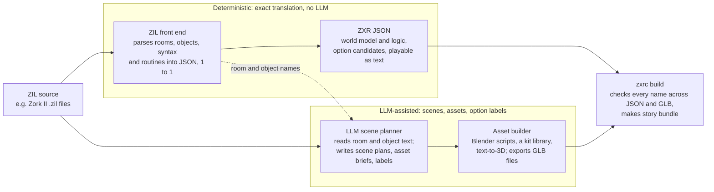
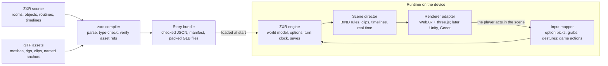
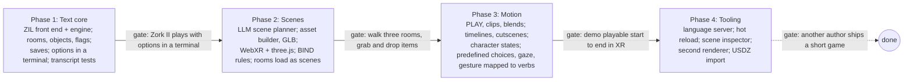

# ZXR: an XR interactive fiction language

2026-10-21 · Mark Davey

## Summary

**The goal (Mark, 2026-10-21):** take an existing ZIL game, cross-compile it with an LLM-assisted compiler into ZXR, so each room becomes a 3D place and typed commands become options the player picks.

ZXR is a new language and runtime that keeps ZIL's world model (rooms, objects, flags, verbs, a parser) and adds 3D scenes, animated assets and spatial interaction for XR. Games are written entirely in JSON and run on a new headless engine, not the Z-machine, because the Z-machine has a turn clock but no real-time clock, no space and no assets.

The core rule: **the world model stays authoritative and textual; the 3D layer is a view of it.** Every room, object and state change exists in the model first, and scenes, animations and audio react to that state. A ZXR game can therefore always run as plain text, which keeps it testable, saveable and accessible.

**Scene format (decided 2026-10-21):** Mark confirmed GLB, the single-file binary form of glTF 2.0. Each room or asset is one `.glb` holding meshes, rigs and animation clips, and a thin ZXR manifest names the anchors and clips the game uses.

## The cross-compiler: ZIL in, XR out

The cross-compiler splits the job in two: a normal compiler translates the game's rules exactly, and the LLM only invents what ZIL never had, which is how each place looks and moves.


*Logic is translated exactly; only the 3D world is imagined by the LLM.*

**Why the split matters:** if an LLM rewrote the routines, it could quietly break a puzzle or a score, and nobody would know until a player got stuck. ZIL's rules are already precise, so translating them is a parsing job. ZIL's descriptions, on the other hand, are prose ("You are in the living room. There is a doorway to the east, a wooden door with strange gothic lettering to the west..."), and turning prose into a 3D place is exactly what an LLM is good at.

**What each stage does:**

1. **ZIL front end (no LLM).** Parses `ROOM`, `OBJECT`, `SYNTAX` and `ROUTINE` forms and writes them out as ZXR JSON, one ZIL form to one JSON block. The result is a playable text game, checked against the original with transcript tests.
2. **LLM scene planner.** For each room it reads the `DESC`, `LDESC`, exits and the objects that start there, and writes a scene plan: size and style of the space, where each exit sits, anchor points for each object, lighting, sound. For each object and character it writes an asset brief ("brass lantern, hand-held, warm glow when on") and the clips it needs (`flicker`, `open`, `move`).
3. **Asset builder.** Turns briefs into GLB files. Three sources, cheapest first: reuse a model from a kit library; have the LLM write a Blender Python script that assembles the room from kit parts; or call a text-to-3D generator for one-off props. Characters get a stock rig and a shared animation library.
4. **zxrc build.** Checks that every anchor, clip, hotspot and routine named anywhere exists, then packs the story bundle.

**A person stays in the loop.** The LLM's scene plans and asset briefs are JSON too, so an author can review and edit them before assets are built, and re-running the build keeps their edits. Every LLM output is cached, so the same ZIL file gives the same game on every build.

## What we keep from ZIL and what changes

We keep ZIL's authoring model almost intact and replace the machine underneath it.

| ZIL / Z-machine idea | In ZXR |
|---|---|
| Lisp-like `<ROUTINE ...>` syntax | Replaced by JSON (decided). Same concepts and names, so ZIL authors still recognise everything |
| `<ROOM>` and `<OBJECT>` with properties and flags | Kept, plus a `SCENE` property and spatial properties (`POSE`, `BOUNDS`, `ANCHOR`) |
| Object tree (`LOC`, `MOVE`, `IN?`) | Kept as the single source of truth; the scene graph mirrors it |
| Parser: verbs, syntax lines, prepositions, `PRSO`/`PRSI` | The middle of `PARSER` (reading and resolving typed words) is replaced by option picks, which fill in the same match tables and globals it would have set; its context reset and its closing checks (`MANY-CHECK`, `TAKE-CHECK`) still run |
| Action routines and `M-BEG`/`M-END` room hooks | Kept unchanged. No new game hooks: anything that happens in 3D reaches the game only as an ordinary option |
| Main loop, `PERFORM` and the turn clock (`QUEUE`, `CLOCKER`, interrupts) | Translated unchanged, including which verbs cost a turn; a separate real-time clock drives animation only |
| `TELL` text output | Kept; text can render as captions, a journal, or narration audio |
| Z-machine bytecode, 64-256 KB memory, versions 3-8 | Bytecode is replaced by a headless engine that interprets JSON. Tables, property tables and header reads keep Z-machine memory semantics through a byte-addressed memory image (see [compat-semantics.md](compat-semantics.md)) |
| Fixed-width screen windows | Replaced by spatial UI panels and captions |

Character voices use audio files generated ahead of time by Python TTS models running locally on the Mac mini. The client plays these packaged assets alongside captions and speaking animations. Speaker/text-to-clip mappings belong to the presentation overlay; the headless engine continues to produce authoritative text. Playback and its timing never advance the game clock or change state. The model, voices and file format remain to be selected.

What is new: assets, scenes, timelines, spatial anchors, real-time events and multimodal input. Each is described below.

## Language design

**Decided 2026-10-21: everything in ZXR is written as JSON, logic included.** A game is a folder of `.zxr.json` files holding world data (assets, scenes, rooms, objects, characters, hotspots, timelines) and routines, which are lists of JSON commands. ZXR keeps ZIL's concepts and names; only the notation changes. A published JSON Schema gives editors autocomplete and error checking, and lets visual tools and AI assistants generate valid game files.

### Assets

An asset names a glTF file and the clips inside it, so code refers to `LAMP-ASSET` and `flicker`, never to file paths. Clip names are lowercase everywhere, matching rougeXR's clip contract (`idle`, `move`, `attack`, `hurt`, `death`, plus `talk` and object clips such as `open`).

```json
"assets": {
  "LAMP-ASSET": {
    "file": "assets/brass_lantern.glb",
    "clips": ["idle", "flicker", "swing"],
    "sounds": { "ON": "sfx/click.ogg", "OFF": "sfx/click2.ogg" }
  }
}
```

### Rooms with scenes

A room gains a `SCENE` property. The scene is the 3D environment the player stands in while `HERE` is that room.

```json
"rooms": {
  "LIVING-ROOM": {
    "desc": "Living Room",
    "ldesc": "You are in the living room. A trophy case stands here.",
    "scene": "WHITE-HOUSE-INTERIOR",
    "exits": {
      "west": "KITCHEN",
      "down": { "to": "CELLAR", "if": { "op": "is", "flag": "TRAP-DOOR.open" } }
    },
    "flags": ["land", "lit"],
    "action": "LIVING-ROOM-F"
  }
}
```

### Objects with bodies

An object gains `MODEL`, `POSE` and `GRAB`. Its location in the object tree decides where it appears: in a room it sits at its pose, in the player it attaches to a hand or the inventory belt.

```json
"objects": {
  "LAMP": {
    "in": "LIVING-ROOM",
    "nouns": ["lamp", "lantern", "light"],
    "adjectives": ["brass"],
    "desc": "brass lantern",
    "model": "LAMP-ASSET",
    "pose": { "at": [1.2, 0.9, -0.4], "face": 90 },
    "grab": "one-hand",
    "flags": ["takeable", "light"],
    "action": "LAMP-F"
  }
}
```

### Action routines that animate

Routines stay turn-based, with new opcodes that request presentation without blocking logic: `PLAY`, `CUE`, `LOOK-AT` and `SAY`. They only emit presentation events; the routine carries on at once.

```json
"routines": {
  "LAMP-F": [
    { "op": "if", "cond": { "op": "verb?", "verbs": ["LAMP-ON"] }, "then": [
      { "op": "set", "flag": "LAMP.on" },
      { "op": "play", "object": "LAMP", "clip": "flicker" },
      { "op": "cue", "name": "LIGHT-UP-ROOM" },
      { "op": "tell", "text": "The lamp is now on." }
    ]},
    { "op": "if", "cond": { "op": "verb?", "verbs": ["LAMP-OFF"] }, "then": [
      { "op": "clear", "flag": "LAMP.on" },
      { "op": "play", "object": "LAMP", "clip": "idle", "blend": 0.3 },
      { "op": "tell", "text": "The lamp is now off." }
    ]}
  ]
}
```

`{"op": "set", "flag": "LAMP.on"}` is the fact; `play` and `cue` are how the fact looks. Removing the presentation commands leaves a correct text game.

Every command and every expression is a JSON object with an `op` key naming what it is; the other keys are its arguments. JSON objects have no member order, so meaning never depends on which key comes first, and reformatting a file cannot change a game. The schema rejects objects without an `op` or with unknown keys for that `op`. Commands and expressions have separate schemas. Flags are written `OBJECT.flag`. The core set maps one-to-one onto ZIL:

| JSON command | ZIL equivalent | Meaning |
|---|---|---|
| `{"op": "set", "flag": "LAMP.on"}` | `<FSET ,LAMP ,ONBIT>` | Set a flag |
| `{"op": "clear", "flag": "LAMP.on"}` | `<FCLEAR ,LAMP ,ONBIT>` | Clear a flag |
| `{"op": "move", "object": "LAMP", "to": "PLAYER"}` | `<MOVE ,LAMP ,PLAYER>` | Move in the object tree |
| `{"op": "tell", "text": "..."}` | `<TELL "..." CR>` | Show text |
| `{"op": "if", "cond": ..., "then": [...], "else": [...]}` | `<COND ...>` | Branch |
| `{"op": "call", "routine": "LAMP-F"}` | `<LAMP-F>` | Call a routine |
| `{"op": "perform", "verb": "OPEN", "prso": "TRAP-DOOR"}` | `<PERFORM ,V?OPEN ,TRAP-DOOR>` | Run an action through normal dispatch |
| `{"op": "is", "flag": "TRAP-DOOR.open"}` | `<FSET? ,TRAP-DOOR ,OPENBIT>` | Condition: test a flag |
| `{"op": "and", "args": [...]}`, `{"op": "or", "args": [...]}`, `{"op": "not", "arg": ...}` | `<AND>`, `<OR>`, `<NOT>` | Combine conditions |

Presentation commands (`play`, `cue`, `move-to`, `look-at`, `say`) use the same `op` shape; timelines add `wait-anim`. They only emit presentation events and never change the world model.

### Timelines

A timeline is a named, sequenced cutscene or effect. It can run while options stay live (ambient) or take control (cinematic). Timelines are presentation only: the engine has already resolved the turn before a timeline starts, so skipping or speeding one up never changes the game.

```json
"timelines": {
  "TROLL-ENTRANCE": {
    "mode": "cinematic",
    "steps": [
      { "at": 0.0, "do": { "op": "play", "object": "TROLL", "clip": "roar" } },
      { "at": 0.4, "do": { "op": "camera-shake", "amount": 0.2 } },
      { "at": 1.5, "do": { "op": "move-to", "object": "TROLL", "anchor": "DOORWAY-MARK", "speed": 1.2 } },
      { "at": 3.0, "do": { "op": "say", "object": "TROLL", "text": "The troll blocks your way." } },
      { "at": "end", "do": { "op": "return-control" } }
    ]
  }
}
```

### Reactive state bindings

`BIND` ties a visual property to a flag or global, so authors do not have to remember to animate every state change.

```json
"objects": {
  "TRAP-DOOR": { "bind": { "open": { "clip": "open" }, "!open": { "clip": "closed" } } }
},
"rooms": {
  "LIVING-ROOM": { "bind": { "lit": { "lighting": "WARM" }, "!lit": { "lighting": "DARK" } } }
}
```

### Spatial anchors

An anchor is a named point in a scene (`DOORWAY-MARK`, `TABLE-TOP`). Objects, characters and timelines refer to anchors, so a scene can be re-laid-out without editing code. In AR, anchors can also bind to real surfaces (`FLOOR`, `TABLE`, `WALL`).

## Scenes, assets and animation

Scenes are glTF 2.0 files plus a small ZXR manifest; animation is driven by world state, not by hand-placed calls alone.

### Why glTF

- Open Khronos standard, exported by Blender, Maya and most DCC tools.
- Carries meshes, PBR materials, skeletons, skins, morph targets and keyframe clips in one GLB.
- Loads natively in three.js, Babylon.js, Godot, Unity (glTFast) and Unreal, so the runtime is not tied to one engine.
- USD is the stronger choice for large film-style pipelines and Apple Vision Pro; we can add a USDZ importer later without changing the language.

### The scene manifest

A `SCENE` form points at a GLB and names the nodes inside it that the game cares about. Named glTF nodes become anchors; the rest is scenery.

```json
"scenes": {
  "WHITE-HOUSE-INTERIOR": {
    "file": "scenes/white_house_interior.glb",
    "anchors": ["DOORWAY-MARK", "TABLE-TOP", "TRAP-DOOR-MARK", "CASE-SHELF"],
    "spawn": "PLAYER-START",
    "lighting": { "WARM": "light_rig_warm", "DARK": "light_rig_dark" },
    "ambient": "audio/house_room_tone.ogg"
  }
}
```

The compiler checks at build time that every named anchor, clip and light rig exists in the GLB, so a typo is a compile error, not a runtime crash.

### Hotspots and triggers

A hotspot is a named region inside the GLB that reacts when the player enters it, looks at it, points at it or touches it. Artists place hotspots in Blender; authors decide in ZXR what they do.

**The rule:** a hotspot can do one of two things. It can **submit an option**, exactly as if the player had picked that option's chip, so the action goes through normal dispatch, the clock and the revision check. Or it can play **presentation effects** (clips, sounds, hints) that never touch the world model. A hotspot never runs game code or changes state directly. This keeps a headless replay of option ids identical to a 3D playthrough, whatever the frame rate or presenter.

**In Blender:** add an Empty (box or sphere) or a hidden mesh where the hotspot should be, name it, and give it a custom property such as `zxr_hotspot = true`. Blender exports custom properties into the GLB as glTF "extras", so the hotspot travels inside the same file as the room.

**In ZXR:** a `HOTSPOT` form binds that node to triggers and a handler.

```json
"hotspots": {
  "CELLAR-STAIRS": {
    "scene": "WHITE-HOUSE-INTERIOR",
    "node": "hs_cellar_stairs",
    "on": {
      "near": { "metres": 1.5, "effects": [{ "op": "play", "object": "CELLAR-DOOR", "clip": "creak" }] },
      "gaze": { "seconds": 1.0, "effects": [{ "op": "cue", "name": "SHOW-HINT" }] },
      "touch": { "option": "WALK:PLAYER:DOWN" }
    },
    "once": ["near"]
  }
}
```

Touching the stairs submits the same `WALK:PLAYER:DOWN` option as the exit marker, so `V-WALK`, the room's hooks, the clock and any hazards all run as usual. If the option is not on offer right now (the trap door is closed), the touch does nothing in the game; the presenter may show a hint.

| Trigger | Fires when | Typical use |
|---|---|---|
| `ENTER` / `EXIT` | The player's head or body enters or leaves the volume | Ambient line, music, lighting change (effects only) |
| `GAZE n` | The player looks at it for n seconds | Hints, highlighting an object's chips |
| `POINT` | The player aims a hand ray at it and pinches | Submit an exit or a distant switch's option |
| `TOUCH` | A hand or held object overlaps it and the player presses (pinch, trigger, or a short dwell then release) | Submit an option: a button, a lever, a door |
| `NEAR d` | The player is within d metres | Characters turn to look at you, music swells (effects only) |

Only deliberate triggers (`POINT`, `TOUCH`) may submit an option, so walking around a room can never take a game turn. One press commits at most one option, however long the hand stays in the volume and whichever hand presses. Ambient triggers (`ENTER`, `EXIT`, `GAZE`, `NEAR`) play effects only.

The artist can also wire a hotspot from Blender alone: a custom property `zxr_option = "OPEN/1:PLAYER:TRAP-DOOR"` on the node needs no `HOTSPOT` form at all. Option ids are written by one shared encoder. `zxr build` checks that every id named in a GLB is well formed and names a real verb, syntax line, actor and object, so a renamed object is caught at compile time; whether the option is available is decided by the engine at run time. Hotspot volumes export their shape and size, and hotspot ids are scoped to their scene.

**Rules that keep it safe:**

- A submitted option goes through `execute()` with the current epoch and revision, exactly like a chip. A stale or unavailable option is rejected and changes nothing.
- `ONCE` stops an effect replaying; whether an option is available is decided only by the engine.
- `zxr build` checks that every `NODE` named in a `HOTSPOT` exists in the GLB.
- A debug view draws all hotspot volumes in the headset so authors can see and tune them.
- If a future game truly needs real-time story events, they will be specified separately, with a text-mode equivalent and a place in the input log, saves and replays. Zork II does not need them.

**Clip events:** the same idea works on time instead of space. A baked clip can carry named markers (for example `FOOTSTEP` or `SWORD-HITS` at a given frame), and `"clip-events": { "TROLL.SWORD-HITS": [ ... ] }` plays effects at that moment: sounds, particles, camera shake. Clip events never change game state, because frame timing differs between devices. glTF has no native marker field, so markers travel in the clip's extras or in the ZXR asset form.

### Three kinds of animation

| Kind | Driven by | Example |
|---|---|---|
| Clip | A named glTF animation, via `PLAY` or `BIND` | Lamp `flicker`, door `open` |
| Procedural | Runtime motion: `MOVE-TO`, `LOOK-AT`, `FOLLOW` | Thief walks to `DOORWAY-MARK` and turns to face the player |
| Timeline | A scripted sequence of the above on a real-time clock | Troll entrance cutscene |

Clips can blend (`BLEND 0.3`), layer (upper-body over walk) and loop. Characters get a simple state machine (`idle`, `move`, `talk`, `attack`) chosen from their current verb and location, so most characters need no per-line animation calls.

### Characters with baked Blender animation

Characters are rigged people or creatures modelled and animated in Blender, exported as GLB, and played back by name. The game never edits their keyframes; it only chooses which baked clip runs and when.

**Blender to ZXR pipeline:**

1. Model and rig the character in Blender (armature plus skinned mesh, optional shape keys for faces and lip sync).
2. Animate each motion as its own Blender Action: `idle`, `move`, `talk`, `roar`, `attack`, `death`.
3. Push each Action to an NLA track and export as GLB. Every Action becomes a named glTF animation clip.
4. The ZXR `ASSET` lists those clip names, and `zxr build` fails if a name is missing from the GLB.

```json
"assets": {
  "TROLL-ASSET": {
    "file": "characters/troll.glb",
    "clips": ["idle", "move", "talk", "roar", "attack", "death"],
    "face-keys": ["blink", "jaw-open", "snarl"]
  }
},
"characters": {
  "TROLL": {
    "in": "TROLL-ROOM",
    "nouns": ["troll", "monster"],
    "desc": "nasty-looking troll",
    "model": "TROLL-ASSET",
    "pose": { "anchor": "TROLL-MARK" },
    "states": { "idle": "idle", "moving": "move", "speaking": "talk", "fighting": "attack", "dead": "death" },
    "flags": ["actor"],
    "action": "TROLL-F"
  }
}
```

`CHARACTER` is an `OBJECT` with a body and a state map. The runtime picks the clip from the character's current state, so `{"op": "move-to", "object": "TROLL", "anchor": "DOORWAY-MARK"}` plays `move` on its own and returns to `idle` on arrival.

**How baked clips are played:**

- **Crossfades:** switching clips blends over a short time (default 0.25 s) so motion never pops.
- **Layers:** a clip can play on part of the skeleton only, for example `talk` on the upper body while `move` runs on the legs.
- **Procedural touches on top:** `LOOK-AT` turns the head and eyes toward the player after the baked clip is applied, so characters react to where you stand.
- **Root motion:** walk clips can be baked in place (the runtime moves the character) or with root motion (the clip moves it). In-place is the default because `MOVE-TO` needs exact control.
- **Shared animation libraries:** characters built on the same Blender skeleton can share one animation GLB, so ten villagers do not need ten copies of `WALK`.

### Two clocks

Game logic advances in turns, as in ZIL. Presentation runs on a real-time clock at the headset's frame rate. A turn ends when its routine returns, even if animations it started are still playing. `wait-anim` is a timeline step, not a game opcode: it lets a cinematic timeline wait for a clip to finish before its next step. Game code never waits on the renderer.

## Runtime architecture

The compiler turns source and glTF assets into one story bundle; on the headset, the engine owns all game state and a separate scene director turns state changes into animation.


*The engine owns the world; the scene director only draws it.*

- **zxrc compiler:** parses ZXR source, resolves objects and syntax lines, and checks every asset, clip and anchor name against the GLB files. Output is a `.zxb` bundle: checked JSON, a scene manifest and packed assets.
- **ZXR engine:** a headless TypeScript engine, following rougeXR's engine contract, that interprets the validated JSON directly and runs the world model, actions and turn clock. It has no rendering code and runs the same in a terminal, a browser or a headset.
- **Scene director:** listens to disclosed presentation events (something the player can perceive moved, opened or lit; `PLAY`, `CUE`; room changed), applies `BIND` rules and runs timelines on the real-time clock. Internal changes the player cannot perceive never reach it.
- **Renderer adapter:** a thin interface (`load-scene`, `spawn`, `play-clip`, `move`, `caption`) so the same bundle can drive more than one engine. First target: WebXR with three.js, which runs on Quest, Vision Pro and desktop browsers with no app store step.
- **Input mapper:** maps predefined action choices, pointing, grabs and gestures to option picks and sends them to the engine, closing the loop. It never sends anything else.

## Interaction: options instead of a parser

Players never type. Each turn the runtime offers options built from the game's own verbs and objects, shown on things in the 3D room. Picking one fills in exactly what ZIL's parser would have produced, so the translated routines run unchanged: the actor (`WINNER`), the verb (`PRSA`), the objects (`PRSO`, `PRSI`), the direction for movement (`P-WALK-DIR`), and for spoken answers the words themselves in `P-LEXV`. Each of these, plus the exact syntax line and any room feature (a pseudo-object such as the Tea Room's hole), is part of the option's stable id, for example `WALK:PLAYER:NORTH`, `TAKE/1:ROBOT:CAGE` or `ANSWER/1:PLAYER:@WELL`. The parser's own closing checks still run, so using an object you are not holding picks it up first ("(Taken)") within the same turn, exactly as typing would. The details are in [compat-semantics.md](compat-semantics.md#the-parser-adapter).

**How options are built:**

1. **Compile time, no LLM:** the front end lists every `SYNTAX` line with the kinds of object each slot accepts. Nothing is pruned for lacking a "real response": `PERFORM` asks the actor, the room, the pre-action, the indirect object, the container and the direct object in turn, so a response can come from many places, and guessing wrong would hide a puzzle. Static analysis of those handlers is used only to rank options.
2. **Compile time, LLM:** writes a natural label for each ("Light the brass lantern") and ranks them per object.
3. **Run time:** each turn the engine pairs syntax lines with the objects in scope (visible and reachable from the actor's point of view, light permitting) and shows the highest-ranked first. Computing options never changes the game: it is a pure query with no effect on state, the RNG or the save hash.

| Option type | Shown as |
|---|---|
| Act on an object | Label chips over the object when the player looks at it or reaches toward it |
| Use one object on another | Pick up the first, then chips appear on valid targets ("Put lamp in trophy case") |
| Move | A marker in each doorway or path, including blocked ones (trying costs a turn and prints the original refusal); pick it to walk there |
| Talk to a character | Predefined dialogue choices beside the character |
| Always available | Look, wait, inventory, score and save on a wrist menu. As in the original, look, wait and inventory cost a turn; score and save do not |
| More actions | Every other legal action for an object, one page further down, so nothing is ever unreachable |
| Say a word | A word picker built from the game's own vocabulary (about 690 words), for answers and spells |

Players pick with gaze and pinch, a controller trigger, touch or keyboard. Every non-movement action has a predefined text string associated with its structured action; dialogue and puzzle answers are selected from authored choices. There is no microphone input, speech recognition or speech-to-text. Hotspots from the GLB feed the same actions, so touching the trap door and picking "Open the trap door" do the same thing.

**The puzzle problem:** many ZIL puzzles depend on the player thinking of an action, such as saying a magic word or tying a rope to a railing. A full option list gives those answers away. Proposed rules, to be confirmed by Mark and playtested:

- **Words are picked, not offered.** Where the game reads a typed word (the riddle's answer, the wand's spells), the player chooses it from the full vocabulary list, so they still have to think of it. No option ever spells out the answer.
- **Knowledge gating, used sparingly:** an option may be ranked lower or held back until the player has a reason to know it, for example a magic word after reading the scroll. Gates must never make a legal action permanently unreachable: every gated action is still reachable through "more actions" or the word picker. Gate state is part of the save, survives restore, and is reset by restart. Changing a gate is a rule change and reruns the conformance and reachability tests.
- **Plausible extras:** each object also shows a few reasonable actions that do not solve anything, so the list is not just a list of solutions.
- **Ranking, not a cap:** the top 6 to 8 options per object show first, and the rest are one tap away under "more actions".

## Platforms: one build for headset, tablet and desktop

**Decided 2026-10-21 (Mark):** the ZXR runtime runs in web browsers on desktops and tablets as well as in XR headsets, like Mark's RogueXR project. One story bundle serves all three; the runtime picks a mode for the device it finds.

| Device | View | How the player picks options | Moves between rooms |
|---|---|---|---|
| XR headset (WebXR immersive) | Stand inside the room | Gaze and pinch or controller | Point at an exit marker |
| Tablet (touch browser) | First-person view; drag to look around | Tap an object, then tap a chip | Tap an exit marker |
| Desktop (mouse and keyboard) | First-person view; mouse to look, WASD to step | Click an object, then click a chip; number keys for the list | Click an exit marker |

- **Same game, same saves:** the engine and world model are identical in every mode; only the input mapper and camera change. A save made on a tablet loads in a headset.
- **Options suit every screen:** because play is option-based, no mode needs a keyboard for commands, which is what makes tablets work.
- **Scale assets per device:** the build can emit lighter GLB variants (fewer polygons, smaller textures) that tablets load instead of the headset versions.
- **AR is optional:** where a browser supports WebXR AR (for example Chrome on Android), a room can also be placed on a real table.

## Building on rougeXR

ZXR should reuse the architecture of Mark's [rougeXR](https://github.com/kariato/rougeXR), which already wraps a classic text-era game (Rogue 5.4.4) in a browser engine that runs on desktop, touch and WebXR. The two projects share almost every concept; only the game engine in the middle differs.

| Concept | rougeXR today | ZXR equivalent |
|---|---|---|
| Stack | TypeScript, Vite, three.js, Vitest, Playwright | Same |
| Headless engine | Imports no DOM, three.js, WebXR or clock; `execute(action)` returns an `ActionResolution` with events | Same contract, but the engine interprets ZXR JSON instead of Rogue rules |
| Actions | Typed `GameAction` union with `expectedRevision` checks | Each option is a `GameAction` such as `{ kind: 'act', actor: 'PLAYER', verb: 'OPEN', syntax: 1, prso: 'TRAP-DOOR' }`, checked against an epoch and revision |
| What the renderer sees | `PlayerObservation`: only disclosed cells and entities | Only what ZIL says the player can perceive, so a dark room really is dark |
| Determinism | Seeded RNG, replay bundles, divergence hashes | Same; replays double as transcript tests against the original ZIL |
| Saves | Named JSON checkpoints and IndexedDB autosave | Same format and stores |
| Views | 2D map, first-person, orbit and tabletop cameras; desktop first, XR as an adapter | Text panel, first-person, tabletop; same order of work |
| Spatial UI | Menus and inventory work with mouse, touch and controller rays | Option chips and the wrist menu use the same components |
| Assets | One Blender Python generator per asset makes `.blend`, `.glb` and a preview PNG; NLA tracks become clips; primitive fallbacks while loading | The LLM asset builder writes generators in this exact format |
| Clip contract | `idle`, `move`, `attack`, `hurt`, `death` | Same five, plus `talk` and object clips such as `open` |
| Hosting | GitHub Pages workflow | Same, with the itch.io page linking to it for VR |

**Changes this makes to the design above:**

- **No custom bytecode.** rougeXR shows a headless TypeScript engine is enough. ZXR's engine can interpret the validated JSON directly, which is simpler to build and debug than a bytecode VM.
- **Shared packages.** XR session handling, spatial menus, the virtual joystick, the asset cache and the save store could move out of rougeXR into a shared library both projects use.
- **The asset builder has a template.** rougeXR's [monster asset pipeline](https://github.com/kariato/rougeXR/blob/main/docs/MONSTER_ASSET_PIPELINE.md) already defines conventions (metres, facing, in-place locomotion, clip order) that LLM-written generators can follow and be validated against.

## Save, determinism and tooling

The headless engine owns both world state and execution state, and the game is fully testable without a headset. The detailed [compatibility review candidate](compat-semantics.md) specifies continuation checkpoints, host completions and transaction boundaries.

- **Saves:** a versioned envelope holding the semantic build hash, memory image, full interpreter continuation, checkpoint kind, knowledge gates and RNG state. Successful primitive RESTORE reinstates the saved SAVE continuation. A save only loads into its semantic build. External export is allowed only at an ordinary input boundary. Animation state is not saved; on load, `BIND` rules and the room's scene rebuild the visuals from state.
- **Determinism:** logic uses a seeded RNG and turn order only, never frame timing. The same build, initial seed/checkpoint and complete accepted input log (options, decisions and host results with immutable restore data) give the same semantic state. Conformance tests replay the original interpreter's recorded random draws, so random events can be compared exactly too.
- **Headless mode:** `zxr run --text game.zxb` plays the game in a terminal. Transcript tests (a list of commands and expected output) run in CI, as Infocom's testers did with scripts.
- **Asset check:** `zxr build` validates every `ASSET`, `SCENE`, clip and anchor reference against the GLB files.
- **Hot reload:** in the editor preview, recompiling a routine or swapping a GLB updates the running scene without losing game state.
- **Editor support:** a language server for syntax highlighting, go-to-definition on objects, and a scene inspector that lists anchors from the GLB.

## Roadmap

Build the text core first, then add scenes, then motion and input, so every phase ends in something playable. No dates yet; they depend on team size and target device.


*Each phase ends in something playable. The detailed 12-phase version is in [build-plan.md](build-plan.md).*

The test game is a real ZIL game. Phase 1 passes when it plays start to finish with options in a terminal, matching the original's transcripts. Phases 2 and 3 start with a three-room slice of Zork II, including one character, then widen to the whole map.

## Open questions for Mark

- [ ] **Scene format:** decided: GLB files plus a ZXR manifest.
- [ ] **Target devices:** decided: web browsers first, running on XR headsets, tablets and desktops from one build.
- [ ] **VR, AR or both:** should rooms be full virtual environments, or should scenes also place onto real tables and floors? Deferred until after the itch.io release, like the phase 4 tooling (hot reload, USDZ, a second renderer).
- [ ] **Syntax:** decided: everything in JSON, logic included.
- [ ] **Legacy games:** decided: cross-compiling existing ZIL games is the main goal.
- [ ] **First game:** Mark's test: cross-compile an open-source ZIL game and publish it on itch.io. Decided: Zork II, whose source Microsoft released under the MIT license in Nov 2025, starting with a three-room slice. To check: the MIT license covers the code, not the Zork name, and itch.io's embedded player may not allow WebXR's immersive mode, so the VR build may need its own page linked from itch.
- [ ] **Asset source:** kit library plus Blender scripts (consistent look, more upfront work), text-to-3D generation (fast, uneven quality), or artists working from LLM briefs?
- [ ] **Puzzle answers:** Claude proposed, in its assessment of the first design review, a vocabulary word picker for typed answers and gates that never hide an action permanently. Mark has not yet accepted this as a decision, and it needs a playtest. Is it the right approach, or should puzzle answers stay typed on desktop?
- [ ] **Language name:** ZXR is a working name.
- [x] **Repository:** created as `kariato/zxr` (2026-10-21). Starting phase 0 of the build plan waits for Mark's go.
